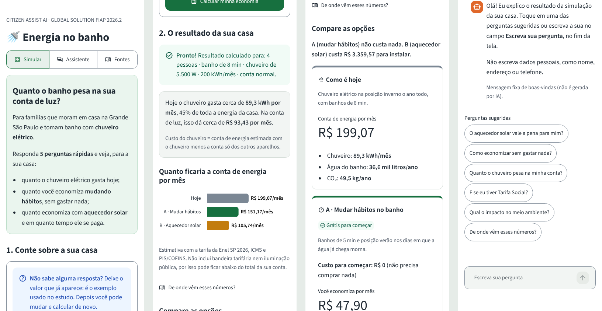

# Citizen Assist AI · Energia no banho

Global Solution 2026.2 — **Soluções em Energias Renováveis e Sustentáveis (SERS)** · FIAP · Ciência da Computação

> Assistente que ajuda famílias da Grande São Paulo a reduzir o gasto com o **chuveiro elétrico**, comparando o uso atual, práticas de uso eficiente e **aquecimento solar térmico** com dados públicos, cálculos verificáveis e uma IA generativa que responde **apenas** com base nesses cálculos.

- **App online:** https://citizen-assist-ai-sers-fwnb3a5vpzskwhxhttqnrm.streamlit.app/
- **Vídeo (YouTube, não listado):** https://youtu.be/vqQ1qcr75XE

## Integrantes

| Nome | RM |
| --- | --- |
| Matheus Pimenta Martini | 569400 |
| Lucas Seiji | 569673 |
| Leonardo Soares Rodrigues | 572986 |

## Público e problema

**Público:** famílias que moram em **casas** na Região Metropolitana de São Paulo (Enel SP) e aquecem a água do banho com chuveiro elétrico, com atenção às famílias de baixa renda (Tarifa Social e Desconto Social).

**Necessidade energética:** banho quente diário. O chuveiro tem alta potência (5.500 a 7.500 W) e, numa família de 4 pessoas com banhos de 8 minutos, gasta cerca de **89 kWh/mês** — perto de **45% de uma conta de 200 kWh**. No inverno a água chega mais fria (≈16 °C em julho) e o problema aumenta.

**Pergunta do projeto:** para a mesma necessidade (banho a 40 °C), quanto a família economiza mudando hábitos ou instalando aquecimento solar, quanto isso custa, em quanto tempo se paga e qual o impacto ambiental?

## Funcionalidades de energia

1. **Simulador** (seção Simular): a pessoa responde 5 perguntas sobre a casa (moradores, minutos de banho, potência do chuveiro, consumo da conta e desconto social) e toca em **Calcular minha economia**. O app calcula, mês a mês, consumo (kWh), conta de energia (R$), economia, investimento, retorno simples, CO₂ e água para três alternativas:
   - **L0** chuveiro elétrico convencional (situação atual);
   - **A** chuveiro com práticas de uso eficiente (banho de 5 min e posição "verão" quando a água chega morna) — **sem investimento**;
   - **B** aquecimento solar térmico (fonte **renovável**) com o chuveiro como complemento.
2. **Sensibilidade do solar** com premissas incertas (coletor de menor desempenho aceito pelo INMETRO; ducha de maior vazão).
3. **Assistente Citizen Assist AI** (seção Assistente), com perguntas sugeridas:
   - **IA generativa (Ollama Cloud)**: recebe uma *ficha de cálculo* com os números da simulação, fontes e limitações, e só pode usá-los. Um **verificador** confere os números da resposta e avisa se algum não estiver nos cálculos.
   - **Modo cálculo**: se a IA estiver sem chave, fora do ar ou sem cota, o assistente responde por regras a partir dos mesmos cálculos e se identifica como **"não é IA generativa"**.
4. **Método, fontes e limitações** (seção Fontes) com links.

### Interface

Feita primeiro para o celular: apresentação, perguntas e resultado numa mesma página, em linguagem simples, com cartões comparativos e o cenário pessimista ao lado do otimista. Decisões, contraste conferido (WCAG AA) e verificação: [`docs/interface.md`](docs/interface.md).



## Principais resultados (cenário de referência)

Família de 4 pessoas, banho de 8 min, chuveiro de 5.500 W, conta de 200 kWh/mês, tarifa convencional da Enel SP, clima de 2016–2025. Fonte: [`docs/resultados.md`](docs/resultados.md) (gerado pelo código).

| Alternativa | Chuveiro (kWh/ano) | Conta de energia (R$/mês) | Economia (R$/ano) | Investimento | Retorno simples | CO₂ (kg/ano) | Água (m³/ano) |
| --- | --- | --- | --- | --- | --- | --- | --- |
| L0 · convencional | 1.072 | R$ 199,07 | — | — | — | 49,5 | 36,6 |
| A · uso eficiente | 572 (−47%) | R$ 151,17 | R$ 574,84 | R$ 0 | imediato | 26,9 | 22,9 |
| B · solar + complemento | ≈1 (−99,9%) | R$ 105,74 | R$ 1.119,89 | R$ 3.359,57 | 3,0 anos | 0,1 | 36,6 |

- **B é um limite superior.** Com premissas pessimistas (coletor mínimo do INMETRO + ducha com o dobro da vazão), o sol cobre ~59% da necessidade, a economia cai para R$ 714,93/ano e o retorno vai para 4,7 anos — e o consumo de água do banho dobra (efeito rebote).
- **Tarifa Social:** com 150 kWh/mês, a economia do solar cai para R$ 632,73/ano (retorno 5,3 anos), porque os primeiros 80 kWh já são gratuitos.
- **CO₂:** as emissões evitadas são pequenas porque a eletricidade do SIN é majoritariamente renovável (fator médio de 2025: 0,0461 t/MWh); o ganho principal é econômico e na redução de demanda.

**Recomendação:** comece por A (custo zero, ≈47% a menos no chuveiro e ≈14 mil litros de água a menos por ano). Se houver telhado adequado e recursos, B reduz quase todo o consumo do chuveiro e se paga em 3 a 5 anos; mantenha os hábitos de A junto com o solar para evitar o efeito rebote.

## Como usar e testar

**Online (recomendado):** abra o link do app — nada para instalar.

**Local:**

```bash
git clone https://github.com/MatheusPimentaMartini/citizen-assist-ai-sers.git
cd citizen-assist-ai-sers
python -m venv .venv
# Windows: .venv\Scripts\activate    |    macOS/Linux: source .venv/bin/activate
pip install -r requirements-dev.txt
pytest                         # 62 testes automatizados
streamlit run app.py           # http://localhost:8501 (modo cálculo, sem chave)
python scripts/gerar_resultados.py   # regenera docs/resultados.md e resultados/*.csv
```

Para ativar a IA localmente, copie `.streamlit/secrets.toml.example` para `.streamlit/secrets.toml` e coloque a sua chave do Ollama (arquivo ignorado pelo Git). Passo a passo de publicação, chave, Ollama local e diferenças online × local: [`docs/deploy.md`](docs/deploy.md).

O **Download ZIP** do GitHub contém todo o projeto e **nenhuma chave** — a chave existe apenas no Secrets do servidor.

## Dados (origem, período, unidades)

| Dado | Origem | Período | Unidade | Arquivo |
| --- | --- | --- | --- | --- |
| Irradiação diária horizontal | Open-Meteo (reanálise) | 2016–2025 (3.653 dias) | kWh/m²·dia | `dados/open_meteo_irradiacao_diaria_sp_2016_2025.csv` |
| Temperatura média mensal (≈ água fria) | Open-Meteo | 2016–2025 | °C | `dados/open_meteo_mensal_sp_2016_2025.csv` |
| Irradiação no plano inclinado (34°) | CRESESB SunData / Atlas 2017 | média de longo prazo | kWh/m²·dia | `dados/cresesb_sundata_sao_paulo.csv` |
| Tarifas B1 Enel SP | ANEEL, REH 3.596/2026 | vigência 04/07/2026–03/07/2027 | R$/MWh | `dados/aneel_tarifas_enel_sp_b1_2026.csv` |
| Fator de emissão do SIN | MCTI/SIRENE | 2021–2026 (mensal 2025) | tCO₂/MWh | `dados/mcti_fator_emissao_sin*.csv` |
| Parâmetros (chuveiro, coletor, kit, impostos) | INMETRO, Idec, Komeco, SINAPI, legislação | ver arquivo | ver arquivo | `dados/parametros.json` |

Cada parâmetro em `parametros.json` tem tipo (**oficial**, **literatura**, **estimativa** do grupo ou **premissa**) e fonte. Valores estimados estão identificados como tal.

## Metodologia, justificativas e limitações

Resumo: simulação **diária** de 2016 a 2025 das três alternativas para a mesma necessidade; energia elétrica = potência × tempo; necessidade térmica = vazão × tempo × c × ΔT; coletor solar pelo ensaio INMETRO (PMEe) escalado pela irradiação do dia no plano inclinado; perdas de 15% (NBR 15569) e perda do reservatório no limite do INMETRO; conta mês a mês com tarifa ANEEL + PIS/COFINS + ICMS-SP por faixa. Detalhes, equações, validação e as 9 limitações: [`docs/metodologia.md`](docs/metodologia.md). Referências com links: [`docs/referencias.md`](docs/referencias.md).

Principais limitações: estimativas (não garantias); conta sem bandeiras e COSIP; água fria aproximada pela temperatura do ar; coletor modelado pelo ensaio padrão; investimento SINAPI sem conexões/válvulas; retorno sem juros.

## Testes

- **Técnicos:** 62 testes automatizados (contas à mão, faixas tarifárias, reservatório, falhas da IA, caminho completo na interface sem chave). Ver [`docs/testes_tecnicos.md`](docs/testes_tecnicos.md).
- **Com usuários:** roteiro, registros e ajustes em [`docs/testes_usuarios/`](docs/testes_usuarios/).

## Estrutura

```
app.py                  # interface Streamlit (Simular, Assistente, Fontes)
estilo.css              # ajustes visuais que o tema não cobre (tema em .streamlit/config.toml)
energia/                # cálculos: modelo diário, tarifa, análise, formatação, leitura dos dados
assistente/             # ficha de cálculo, cliente Ollama Cloud, modo cálculo, verificador de números
dados/                  # dados brutos/tratados e parametros.json (com fontes)
scripts/                # coleta do Open-Meteo, geração dos resultados e capturas de tela
resultados/             # tabelas CSV geradas pelo código
docs/                   # metodologia, resultados, referências, deploy, testes
tests/                  # pytest
```

## Uso de IA generativa e segurança

A IA **não calcula nada**: os números vêm do pacote `energia`. Ela só redige a resposta a partir da ficha de cálculo, com regras para citar fontes, deixar claro que são estimativas e não inventar valores. A chave do Ollama Cloud fica apenas no Secrets do Streamlit; não há chave no código, no histórico nem no ZIP. O app não armazena conversas.

Custo: o Ollama Cloud cobra por token com créditos pré-pagos; com o modelo `gpt-oss:20b`, cada pergunta custa menos de US$ 0,001 (estimativa pela tabela oficial de preços). Os limites do app (15 perguntas por sessão e 120 por hora) protegem os créditos.
