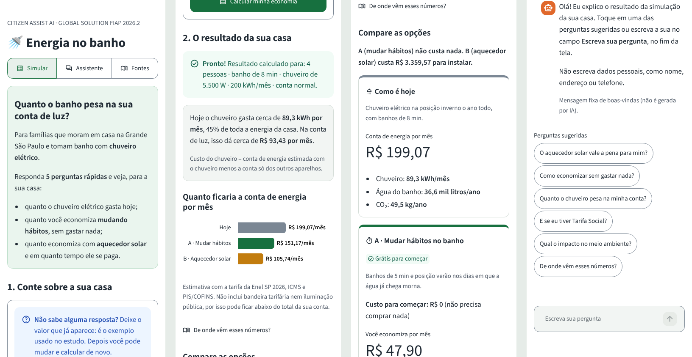

# Interface (UX/UI) — decisões e verificação

Versão 2 da interface, de 17/11/2026. Objetivo: uma pessoa sem experiência com tecnologia consegue usar o app **sozinha, no próprio celular**. Os cálculos, os dados, as fontes e a integração com o Ollama Cloud **não mudaram**; a única informação nova na tela é o custo do chuveiro na conta (seção 3).

## 1. Caminho em etapas

| Etapa pedida | Onde fica | Por quê |
| --- | --- | --- |
| 1. Apresentação | Cartão verde no topo de **Simular** | Diz em 3 linhas para quem é e o que a pessoa vai descobrir, antes de pedir qualquer dado. |
| 2. Informações da casa | Formulário logo abaixo, com botão **Calcular minha economia** | Na versão 1 os dados ficavam na barra lateral, que no celular começa fechada (era preciso achar o **»**). Agora as perguntas estão na própria página. |
| 3. Consumo e resultados | Logo abaixo do formulário; o app rola sozinho até lá | No celular, ler de cima para baixo é o caminho natural: pergunta → resposta. |
| 4. Assistente | Botão **Assistente** no topo e botão **Tirar dúvidas com o assistente** depois do resultado | Fica sempre visível, sem menu escondido. |
| 5. Método e fontes | Botão **Fontes** no topo e **Ver de onde vêm os números** depois do resultado | A transparência não fica escondida. |

A navegação usa três botões grandes (`st.segmented_control`), que cabem numa linha até em telas de 360 px. As respostas do formulário ficam guardadas ao trocar de seção (`st.session_state["casa"]`).

## 2. Formulário

- Os 8 campos da versão 1 foram mantidos, com os mesmos valores iniciais e limites (a exceção é o tempo de banho da alternativa A, explicado abaixo). Os 5 essenciais viraram **perguntas** ("Quantas pessoas tomam banho na sua casa por dia?") com um exemplo ou dica embaixo; os 3 que ajustam as alternativas ficaram em **Ajustar as alternativas (opcional)**, para não assustar quem só quer o resultado.
- O formulário só calcula ao tocar no botão. Assim, o app não recalcula a cada toque num campo, só quando a pessoa termina de responder, e o botão deixa claro o que fazer.
- Se o banho da alternativa A for maior que o banho de hoje, o app usa o tempo de hoje e **avisa**. Na versão 1 o limite do campo mudava sozinho, o que não funciona dentro de um formulário.
- O perfil de tarifa virou "A sua conta de luz tem desconto social?", com quem tem direito explicado em cada opção.

## 3. Resultado

Ordem pensada para responder primeiro a pergunta mais simples:

1. **Resumo em linguagem simples:** "Hoje o chuveiro gasta cerca de 89,3 kWh por mês, 45% de toda a energia da casa. Na conta de luz, isso dá cerca de R$ 93,43 por mês." O valor em reais é novo: `conta com o chuveiro − conta só dos outros aparelhos`, com a mesma tarifa e os mesmos impostos (por isso já considera a mudança de faixa do ICMS). Está em `energia/analise.py`, testado em `tests/test_dados_e_analise.py` (nenhuma alternativa pode economizar mais do que esse valor) e entrou na ficha do assistente.
2. **Gráfico "Quanto ficaria a conta de energia por mês"**: três barras com o valor escrito ao lado. O valor escrito garante que ninguém dependa só da cor ou do tamanho da barra.
3. **Cartões "Compare as opções"**: o que é cada alternativa, quanto economiza (por mês, em destaque, e por ano), quanto custa para começar, em quanto tempo se paga, conta, consumo do chuveiro, água e CO₂. Os selos só aparecem quando os dados confirmam: **Sem custo inicial** (investimento = 0 e economia > 0) e **Maior economia** (maior economia anual entre A e B).
4. **Cenário pessimista no próprio cartão do solar**, para o resultado otimista nunca aparecer sozinho.
5. **O que fazer agora**: as recomendações calculadas (as mesmas da ficha do assistente).
6. Detalhes em seções que abrem ao tocar: consumo mês a mês, "E se o aquecedor solar render menos?" e a tabela completa.

## 4. Assistente

- **Boas-vindas fixas**, identificadas como texto fixo (não é IA), com o aviso para não escrever dados pessoais.
- **Perguntas sugeridas** em botões grandes. Depois da primeira pergunta elas se recolhem em "Ver perguntas sugeridas", para não empurrarem a resposta para fora da tela do celular.
- O campo **Escreva sua pergunta** fica preso no fim da tela.
- A situação da IA aparece antes da conversa: **IA generativa ativa** (verde) ou **Modo cálculo (não é IA generativa)** (azul). Cada resposta também se identifica, e a legenda de fontes aparece embaixo de toda resposta.
- "Como o assistente funciona e quais números ele usa" reúne a explicação, o seletor **Usar IA generativa** e a ficha de cálculo.
- A integração não mudou: mesma ficha, mesmo verificador de números, mesmo cache, limites de 15 perguntas por visita e 120 por hora, e queda para o modo cálculo se a IA falhar. As mensagens de erro ficaram em linguagem simples, com o detalhe técnico no fim.

## 5. Acessibilidade

| Item | Como foi feito | Valor conferido |
| --- | --- | --- |
| Contraste do texto | Texto `#1F2933` sobre branco | 14,8:1 (mínimo AA: 4,5:1) |
| Contraste das legendas | O Streamlit aplica 60% de opacidade; o `estilo.css` volta para 100% e usa `#4B5563` | 7,6:1 |
| Botões verdes | Branco sobre `#17703F` | 6,1:1 |
| Bordas dos campos | `#7B8794` sobre branco | 3,7:1 (mínimo para componentes: 3:1) |
| Alvos de toque | Botões com no mínimo 48 px de altura | conferido pelo script: nenhum botão abaixo de 44 px |
| Não depender só de cor | Selos, avisos e barras sempre com texto e ícone | — |
| Fonte | 17 px de base (o padrão é 16 px) | — |
| Rolagem | Ao calcular, a tela vai até o resultado; ao trocar de seção, volta ao topo | — |

Contrastes calculados com a fórmula de luminância relativa da WCAG 2.1.

## 6. Arquivos

- `app.py`: só a tela (cálculos em `energia/`, assistente em `assistente/`).
- `.streamlit/config.toml`: tema (cores, fonte, cantos arredondados).
- `estilo.css`: o que o tema não cobre (largura de leitura, legendas, botões de 48 px, cartões).
- `scripts/capturar_telas.py`: refaz as capturas e confere rolagem horizontal, tamanho dos botões e erros de JavaScript.

## 7. Como foi verificado

- `pytest`: 63 testes. Os 7 de `tests/test_app.py` fazem o caminho da pessoa sem navegador: abrir, calcular, mudar a potência, ver que as respostas continuam guardadas ao trocar de seção, pedir banho "eficiente" mais longo que o de hoje, perguntar digitando e tocando numa sugestão, limpar a conversa e abrir as fontes.
- App publicado conferido em tela de celular e de computador, com uma pergunta respondida pela IA generativa (registro em `docs/testes_tecnicos.md`).
- `scripts/capturar_telas.py` com Chrome sem janela, em 390 × 844 (celular) e 1280 × 900 (computador): sem rolagem horizontal, nenhum botão abaixo de 44 px e nenhum erro de JavaScript. As imagens desta página saíram desse script (app local, sem chave, por isso aparece o modo cálculo).

## 8. O que ainda falta

- Testes com pessoas de fora da equipe (`docs/testes_usuarios/roteiro.md`). As escolhas acima vêm de uma revisão de usabilidade, **não** de testes com usuários; os testes vão mostrar o que ainda confunde.
- Repetir o checklist manual da equipe no celular de cada integrante com a interface nova.
- A página continua marcada como inglês para leitores de tela (`<html lang="en">`, padrão do Streamlit); não encontramos opção de configuração para mudar isso.
